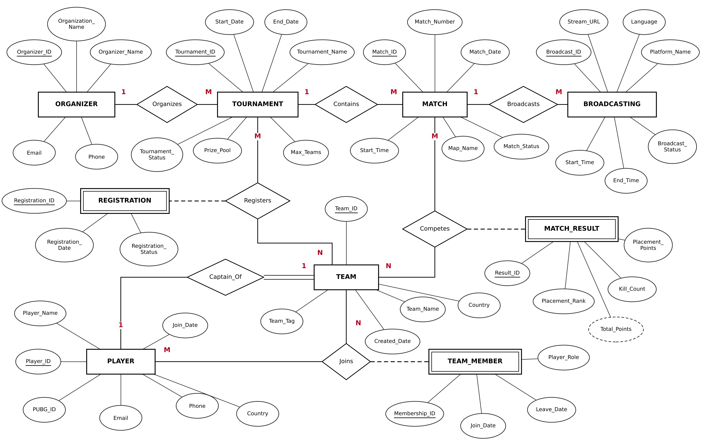
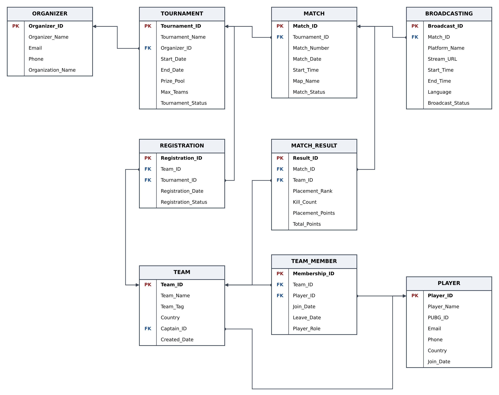

# PUBG Esports Tournament Management System

A relational database design for managing **PUBG Mobile esports tournaments**. It keeps organizers, tournaments, players, teams, registrations, matches, results and live broadcasts in one organized place.

**Course:** CSE384 – Database Design, Southeast University
**Student:** Istiak Ahamed (ID: 2024100000273)
**Department:** Computer Science & Engineering (B.Sc. in CSE)

---

## Why this project?

Many esports events are managed with spreadsheets and chat messages. This causes duplicate team entries, wrong points, outdated player lists and scattered information. This database keeps everything connected and consistent.

## What the database manages

- Tournament organizers
- Tournaments (dates, prize pool, status)
- Players and teams
- Team membership history
- Tournament registrations
- Match schedules
- Team-wise match results
- Live broadcast information

## Database Entities (9)

| Entity | Purpose |
|---|---|
| ORGANIZER | Organizations that host tournaments |
| TOURNAMENT | Tournament details |
| PLAYER | Player profiles |
| TEAM | Teams and their captain |
| TEAM_MEMBER | Players joining and leaving teams (membership history) |
| REGISTRATION | Teams registering for tournaments |
| MATCH | Match schedule inside a tournament |
| MATCH_RESULT | Each team's placement, kills and points in a match |
| BROADCASTING | Live stream details of a match |

## Relationships

| Relationship | Type |
|---|---|
| ORGANIZER – TOURNAMENT | 1:M |
| TOURNAMENT – MATCH | 1:M |
| MATCH – BROADCASTING | 1:M |
| PLAYER – TEAM (through TEAM_MEMBER) | M:N |
| TEAM – TOURNAMENT (through REGISTRATION) | M:N |
| TEAM – MATCH (through MATCH_RESULT) | M:N |
| PLAYER – TEAM (Captain) | 1:1 |

## Important Rules

- Every team has exactly one captain, and a player can captain at most one team.
- The captain must be an active member of the same team.
- A team can have at most four active players at a time.
- A team cannot register twice for the same tournament.
- A team can have only one result per match.
- Tournament standings are calculated from match results, not stored directly.

## ER Diagram

## Relational Schema

## Project Structure
